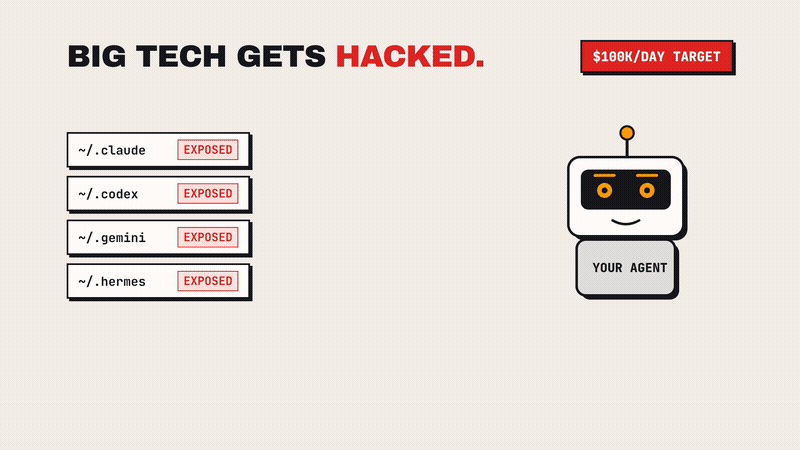

# agent-lockdown

Read-only security audit for your computer **and all the AI agents running on it** — plus a one-click global `.env` secret-file lock and universal agent skill (`SKILL.md`) for **Claude (Desktop & Code), Antigravity (Desktop, IDE & CLI), Cursor, Codex, Hermes, Pi, OpenCode, GitHub Copilot, Grok, Kiro, Factory, and Qwen**.

> **50-second ELI5 video explainer:** How attackers hijack AI agent session histories & startup hooks (`$100K/day` LLM-jacking) and how `agent-lockdown` locks down all 10 agents in 2 seconds.
> **[▶ Play / download full 1080p MP4 with voiceover & SFX](../../raw/main/docs/agent-lockdown-eli5.mp4)**

[](../../raw/main/docs/agent-lockdown-eli5.mp4)

---

## 🟢 Don't Know How to Code or Use the Terminal? Start Here!

If you use **Claude Desktop**, **Antigravity Desktop**, **Cursor**, **Hermes**, or any AI assistant with computer/command access, **you don't need to touch the terminal**.

Just copy and paste this message into your AI agent:

```text
Read https://github.com/Mikehutu/agent-lockdown (and its AGENTS.md file).
1. First, inspect the source code in src/agent_lockdown/ yourself to verify it is safe (zero external dependencies, no data exfiltration, no secret uploads) and tell me what you verified.
2. Once verified, run the read-only security check on my computer and AI agents, and explain what you find in simple ELI5 plain English.
3. Finally, ask my permission before installing the global .env secret-file protection lock (and the agent-lockdown skill) across all my AI agents.
```

**What your AI agent will do automatically:**
1. **Audit this tool's code first** (~4 small Python files, zero external packages) and confirm to you that it is safe.
2. **Run a safe, read-only check** of your AI apps (nothing is changed or deleted).
3. **Tell you in plain English** if any API keys were accidentally saved in old chat logs, if any risky plugins/hooks are installed, and which of your AI apps are currently unprotected.
4. **Ask your permission** before adding a global safety lock so none of your AI apps can secretly read your `.env` password/key files, plus installing the `agent-lockdown` skill so you can ask any of your agents to run a security check anytime.

---

## 🧒 ELI5 ("Explain Like I'm 5"): What Is This and Why Do I Need It?

Imagine your AI agent (Claude, Antigravity, Cursor, Codex, Hermes, etc.) is a super helpful assistant that you invited into your house:

1. **The Problem — Unlocked Drawers & Sneaky Tricks:**
   - Your secret API keys and passwords usually live in a file called `.env` (or get pasted into chat by mistake and saved in plain text).
   - Normally your AI assistant is polite. But if it reads a booby-trapped webpage, document, or plugin (**prompt injection** or a **malicious startup hook**), it can be tricked into opening your `.env` file and sending your keys to an attacker.
2. **Part 1: The Home Inspector (The Read-Only Audit):**
   - `agent-lockdown` (`asa`) walks through your computer and checks every AI app installed.
   - **It only looks—it never touches.** It checks for leaked keys in chat history, sneaky startup scripts, risky plugins, and open network ports.
   - **It never shows your secrets on screen** (a key like `sk-proj-123456...` is masked as `sk-pro…(51 chars)`).
3. **Part 2: The Childproof Lock on Your `.env` Secrets (The Global Hook):**
   - Before this tool, people only knew how to lock `.env` files in Claude Code, leaving all their other AI apps wide open.
   - When you tell your agent *"Yes, install the hook"*, it puts a **deterministic lock** (called a `PreToolUse` hook) on **every AI agent on your computer**.
   - Even if an AI agent is tricked by a prompt injection, the lock steps in *before* the file opens and blocks it—while still letting the AI read safe template files like `.env.example`.
   - You can choose between:
     - **Hard Block (`deny` — default):** Automatically blocks any AI from reading `.env` files.
     - **Ask Me First (`ask`):** Pops up a confirmation prompt asking for your permission whenever an AI tries to read `.env`.
4. **Part 3: The Built-in Security Skill (`SKILL.md`):**
   - It also adds the `agent-lockdown` skill to your AI agents so that in the future, you can just tell any agent *"run a security audit"* or `/agent-lockdown` and it already knows how!

---

## 🕵️ "Wait—How Do I Know *This* Repo Isn't a Security Threat?"

You should **never** blindly trust a security tool or let an AI install a global hook without checking it first. This repository is specifically designed so **both a non-technical user (using an AI) and a security engineer** can verify the entire codebase in under 30 seconds:

1. **Zero external dependencies (`dependencies = []` in [`pyproject.toml`](pyproject.toml)):**
   - Most supply-chain attacks hide inside 500 transitive `npm` or `pip` packages. This tool installs **zero** third-party packages and uses only Python's built-in standard library.
2. **Tiny, flat codebase (only 4 Python files in [`src/agent_lockdown/`](src/agent_lockdown/)):**
   - [`data.py`](src/agent_lockdown/data.py) — static CVE table and regex patterns.
   - [`core.py`](src/agent_lockdown/core.py) — read-only scanner.
   - [`hooks.py`](src/agent_lockdown/hooks.py) — the `.env` hook and skill installer. It **does not even import `urllib`, `http`, or `socket`**, and it **never opens your `.env` file**—it only checks the *filename* in the tool request (`".env"`) and blocks the tool before the file is read.
   - [`cli.py`](src/agent_lockdown/cli.py) — command-line flags and output formatting.
3. **Get a "Second Opinion" from any web browser AI first (zero computer access needed):**
   - Before you even run this in your desktop agent, you can paste this into a normal web browser tab (**ChatGPT**, **Claude.ai**, **Gemini**, or **Grok** on the web—which isn't connected to your computer at all):
   ```text
   Please review the code in https://github.com/Mikehutu/agent-lockdown (specifically pyproject.toml, AGENTS.md, and the 4 Python files in src/agent_lockdown/). Tell me in plain English:
   1. Does it install any third-party packages?
   2. Does it ever upload or send my files, passwords, or .env secrets anywhere?
   3. Is it safe to let my desktop AI agent run it?
   ```
   - Because the entire tool is ~2,000 lines of plain Python across 4 files, any AI can read every single line in one pass and verify it for you.
4. **Exact network behavior (transparent `cve.now` lookup):**
   - During a full host audit, Layer 12 (`cve-now`) queries the public **[cve.now](https://cve.now)** feed (`https://cve.now/stack?p=...`) with **only** your installed public PyPI/npm package names and version numbers (e.g. `pypi:requests@2.32.3`) to check for live CVEs—it never sends file contents, paths, hostnames, or secrets.
   - Running `agent-lockdown --agents-only` or `agent-lockdown --offline` makes **zero network calls** at all.
5. **Honest security scope (guardrail, not an OS sandbox):**
   - A `PreToolUse` `.env` hook is a fast, deterministic seatbelt that stops accidental `.env` reads and standard prompt injections (`Read`, `cat .env`, `grep ... .env`, `open('.env')`). It is **not** a replacement for OS-level sandboxing or API provider spend limits—a determined attacker with unrestricted shell access can still obfuscate shell commands. Use both!
6. **100% Reversible (1-Command Uninstall Anytime):**
   - Nothing is hidden or permanent. You (or your AI agent) can remove the `.env` lock anytime with:
     ```bash
     agent-lockdown --uninstall-env-hook --yes
     ```
7. **1-second terminal proof (for developers):**
   ```bash
   # Verify every network call in the entire repo (only cve.now in core.py; zero in hooks.py):
   grep -rnE "urllib|http|socket|requests|fetch" src/ hermes/

   # Verify every file-write call in the entire repo (only in hooks.py when --install-env-hook / --install-skill is used):
   grep -rnE 'open\(.*"w"|write_text|copyfile' src/ hermes/
   ```

---

## 🧩 How to Add `agent-lockdown` as a Skill, Hook, or Plugin to Any Agent

`agent-lockdown` gives your agents **three layers of integration**—and you can install all of them in seconds:

### 1. Add as a Global Skill (`SKILL.md`) to All Your Agents
Installing the skill teaches **Claude**, **Antigravity / Gemini**, **Codex**, **Hermes**, **Cursor**, **Pi**, **OpenCode**, **GitHub Copilot**, **Grok**, and **Kiro** how to run `agent-lockdown` whenever you ask for a security check:

```bash
# Option A: Built-in installer (zero Node/npm needed — installs into ~/.agents/skills, ~/.claude/skills, ~/.hermes/skills, ~/.codex/skills, ~/.gemini/skills, etc.)
agent-lockdown --install-skill

# Option B: Via the Agent Skills CLI (npx skills)
npx skills add Mikehutu/agent-lockdown
```

### 2. Add as an Always-On Global `.env` Protection Hook
Unlike a skill (which the model chooses when to use), a **hook** is enforced by the agent harness before every tool call—even if the model gets prompt-injected:

```bash
# Preview which agents on your computer will get the hook (changes nothing):
agent-lockdown --install-env-hook --dry-run

# Install the global .env hook across all detected agents (asks [y/N]):
agent-lockdown --install-env-hook

# Or install in interactive "ask me every time .env is accessed" mode:
agent-lockdown --install-env-hook --hook-mode ask
```

### 3. Add as a Native Hermes Agent Plugin (`~/.hermes/plugins/agent-lockdown`)
For **Hermes Agent**, `agent-lockdown` ships a native plugin in [`hermes/`](hermes/) (validated against `hermes_cli.plugin_dev.doctor_plugin`) that registers **both**:
- the `agent_lockdown` tool (`toolset="security"`), and
- a native in-process `pre_tool_call` hook that blocks `.env` access (or triggers Hermes's built-in human approval prompt when `ASA_ENV_GUARD_MODE=ask`).

```bash
# Automatically installs ~/.hermes/plugins/agent-lockdown and enables it in ~/.hermes/config.yaml:
agent-lockdown --install-env-hook --hook-agent hermes --yes
```

---

## ⚡ Quick Start for Terminal Users (2 seconds)

```bash
# Run without installing (uvx)
uvx --from git+https://github.com/Mikehutu/agent-lockdown agent-lockdown --agents-only

# Or install globally from GitHub (installs both `agent-lockdown` and `asa` commands)
uv tool install git+https://github.com/Mikehutu/agent-lockdown
```

Or from a local git clone:

```bash
git clone https://github.com/Mikehutu/agent-lockdown
cd agent-lockdown && uv tool install --force .
```

---

## 🛠️ Common Commands (`agent-lockdown` or `asa`)

```bash
agent-lockdown --agents-only                  # fast 4-layer AI-agent check (hooks, MCP, history, rules, supply-chain)
agent-lockdown --quick                        # full host + agent audit, skipping slow venv/git checks
agent-lockdown                                # full 16-layer audit of current dir + all agents in $HOME
agent-lockdown --root ~/projects/app          # audit a specific project
agent-lockdown --layers agent-config,secrets  # run selected layers
agent-lockdown --list-layers                  # list all 16 layers with descriptions
agent-lockdown --install-skill                # install SKILL.md into all detected agents' global skills folders
agent-lockdown --install-env-hook --dry-run   # preview which installed agents would get the global .env hook
agent-lockdown --install-env-hook             # interactively install global .env protection hooks (asks [y/N])
agent-lockdown --install-env-hook --hook-mode ask  # prompt for permission at runtime when .env is accessed
agent-lockdown --uninstall-env-hook           # cleanly remove the global .env protection hooks
agent-lockdown --print-env-hook               # print copy-paste global .env hook configs for all supported agents
agent-lockdown --format json --redact-paths   # shareable CI/issue JSON (replaces $HOME with ~, omits hostname)
agent-lockdown --format sarif --redact-paths  # SARIF 2.1.0 for GitHub Code Scanning / PR checks
agent-lockdown --fail-on warn                 # exit 1 on warnings too
agent-lockdown --offline                      # skip the cve.now network feed
agent-lockdown --show-ok                      # print passing checks as well
```

*(Every command also works via the short alias `asa`, e.g. `asa --agents-only`.)*

Exit codes: `0` clean, `1` findings at/above `--fail-on` (default `vuln`), `2` usage or missing user-permission error.

---

## 🔒 Global `.env` Protection Across All Agents

`agent-lockdown` ships a universal pre-tool hook handler (`asa --run-env-hook`) and native extensions that block both direct file reads (`Read`, `read_file`, `view_file`, `grep`) **and** shell commands (`cat .env`, `grep ... .env.local`, `python3 -c "open('.env')..."`, `base64 secrets.env`) across every installed agent—while allowing safe templates like `.env.example`, `.env.sample`, and `.env.template`.

| Agent | Global Hook / Extension Target | Global Skill Target (`--install-skill`) | Mechanism Installed by `--install-env-hook` |
|---|---|---|---|
| **Claude (Code & Desktop CLI)** | `~/.claude/settings.json` | `~/.claude/skills/agent-lockdown/SKILL.md` | `permissions.deny` (`Read(.env*)`) + `hooks.PreToolUse` |
| **Antigravity (Desktop / IDE / CLI) & Gemini** | `~/.gemini/config/hooks.json` & `~/.gemini/settings.json` | `~/.agents/skills/` & `~/.gemini/skills/` | `asa-env-guard.PreToolUse` JSON hook + `permissions.deny` |
| **Codex CLI** | `~/.codex/hooks.json` | `~/.codex/skills/agent-lockdown/SKILL.md` | `hooks.PreToolUse` (`asa --run-env-hook`) |
| **Hermes Agent** | `~/.hermes/plugins/agent-lockdown/` | `~/.hermes/skills/agent-lockdown/SKILL.md` | Native `pre_tool_call` plugin hook + `agent_lockdown` tool |
| **Pi Coding Agent** | `~/.pi/agent/extensions/asa-env-guard.ts` | `~/.pi/agent/skills/agent-lockdown/SKILL.md` | Global TypeScript extension hooking `pi.on("tool_call", ...)` |
| **OpenCode** | `~/.config/opencode/plugins/asa-env-guard.js` | `~/.config/opencode/skills/agent-lockdown/SKILL.md` | Global JS plugin hooking `"tool.execute.before"` |
| **Cursor** | `~/.cursor/hooks.json` | `~/.agents/skills/agent-lockdown/SKILL.md` | `beforeReadFile` & `beforeShellExecution` (`asa --run-env-hook`) |
| **Grok CLI** | `~/.grok/hooks/asa-env-guard.json` | `~/.grok/skills/agent-lockdown/SKILL.md` | `hooks.PreToolUse` (`asa --run-env-hook`) |
| **GitHub Copilot** | `~/.copilot/hooks/asa-env-guard.json` | `~/.copilot/skills/agent-lockdown/SKILL.md` | `hooks.PreToolUse` (`asa --run-env-hook`) |
| **Kiro CLI** | `~/.kiro/settings/hooks.json` | `~/.kiro/skills/agent-lockdown/SKILL.md` | `hooks.preToolUse` (`asa --run-env-hook`) |
| **Factory / Qwen** | `~/.factory/settings.json`, `~/.qwen/settings.json` | `~/.agents/skills/agent-lockdown/SKILL.md` | `hooks.PreToolUse` (`asa --run-env-hook`) |

See **[AGENTS.md](AGENTS.md)** for the full step-by-step instructions that AI agents follow when setting this up for a user.

---

## 📋 All 16 Security Layers

| # | Layer | Checks |
|---|-------|--------|
| 1 | `host-python` | installed Python packages against a CVE table |
| 2 | `host-node` | npm globals against a CVE table |
| 3 | `docker-containers` | package CVEs inside containers, root user, privileged mode, second daemon |
| 4 | `docker-images` | `:latest` tags |
| 5 | `manifests` | `uv.lock` / `poetry.lock` (every resolved version), unpinned requirements, pyproject floors, `FROM :latest` |
| 6 | `ports` | listening TCP sockets reachable beyond loopback (reads `/proc`, no `ss` needed) |
| 7 | `os-packages` | apt/dnf/apk updates, snap refresh |
| 8 | `ssh` | password auth, root login, fail2ban |
| 9 | `semgrep` | `security/*/semgrep.yml` rules |
| 10 | `secrets` | hardcoded keys in source, `.env` tracked in git |
| 11 | `venvs` | every virtualenv against the CVE table |
| 12 | `cve-now` | installed Python + npm versions against the public [cve.now](https://cve.now) feed |
| 13 | `agent-config` | hooks + MCP servers of **every** agent tool, `settings.local.json` in git, per-agent global `.env` protection status |
| 14 | `agent-history` | provider keys (`sk-ant-`, `sk-proj-`, `sk-or-v1-`, `AIza`, `ghp_`, `hf_`, `AKIA`, …) in agent history **and git history** |
| 15 | `agent-rules` | prompt-injection phrases **and hidden Unicode / ASCII smuggling** in `CLAUDE.md`, `AGENTS.md`, `SKILL.md`, `.mdc` |
| 16 | `supply-chain` | code-executing `.pth`, `sitecustomize`, npm lifecycle scripts (`@scope/pkg`), **skill scripts & editor extensions** |

## Which agents are covered

`AGENT_ROOTS` in `src/agent_lockdown/data.py` lists every tool to audit:
`.claude`, `.codex`, `.copilot`, `.cursor`, `.cursor-server`, `.gemini`, `.pi`,
`.opencode`, `.kiro`, `.grok`, `.openfang`, `.agents`, `.archon`, `.aitk`,
`.aider`, `.continue`, `.cline`, `.windsurf`, `.zed`, `.qwen`, `.goose`, `.amp`,
`.hermes`, and more.

**Add a new tool:** one line in `AGENT_ROOTS`. Nothing else.

## Safety guarantees

- The audit path contains **no** delete, install, upgrade, or file-write path. It reads files and runs query-only commands (`git log`, `docker ps`, `npm list`, …).
- `--install-env-hook` and `--uninstall-env-hook` are strictly opt-in, merge non-destructively into existing JSON configs (preserving existing hooks like `herdr`), and require interactive `[y/N]` confirmation or explicit `--yes`.
- The only network call is the public `cve.now` feed; `--offline` removes even that.
- Secret values are masked before they reach text or JSON output.
- `--redact-paths` strips `$HOME` and hostname before sharing logs or CI artifacts.

## Requirements

- Linux or macOS (`ports` reads `/proc/net/tcp` on Linux and falls back to `lsof` on macOS)
- Python 3.8+ (zero third-party packages required)
- Optional, auto-detected: `docker`, `npm`, `semgrep`, `git`, `apt`/`dnf`/`apk`, `snap`

## License

MIT — see [LICENSE](LICENSE).
